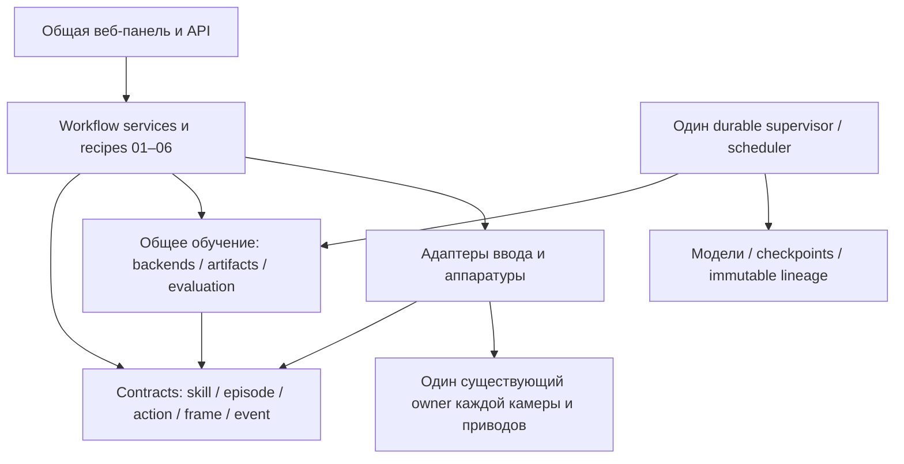

# Аудит архитектуры Explorer · 26 октября 2026

Статус: **IN_PROGRESS, поэтапная миграция**. Документ не объявляет все функции
01–06 завершёнными. Действующие процессы используют закреплённые releases,
а не рабочее дерево. Оригинальные motor owners и настройки ROSMASTER сохраняются.

## Проверяемая карта

`scripts/audit_architecture.py` читает исходники через AST, не импортируя проект
и не открывая устройства. Результаты — `CODE_ARCHITECTURE_INVENTORY_20261026.json`
и `CODE_ARCHITECTURE_IMPORTS_20261026.dot`. Каждый файл имеет SHA, слой,
список импортов; Python-символы имеют строки, AST fingerprints; API — буквальный
route, метод и handler; units — фактические директивы. HEAD и незакоммиченные
изменения записываются явно. Snapshot необходимо пересоздать после миграций.

Первоначальный снимок: 264 модуля, 3376 символов, 89 API-декораторов,
765 разрешённых локальных import edges. Обнаружена одна структурная группа
дубликатов и три близких AST-пары. Это кандидаты для ревью, не доказательство
одинакового поведения. Динамические импорты, общие JS globals, вложенные router
prefix и схожая бизнес-логика дополнительно проверяются вручную ниже.

## Слои и границы

`shared` не импортирует experiment packages. Domain не зависит от FastAPI,
SSH и аппаратных библиотек. UI передаёт намерение сервису; он проверяет
версию/источник, а адаптер использует уже существующий owner. Калибровка,
временная шкала, измерение, командная оценка и диспетчеризация — разные факты.
Файл checkpoint не является разрешением движения.

## Пересечения и решения

| Подсистема | Фактические реализации / потребители | Различие и риск | Общий контракт / решение |
|---|---|---|---|
| Identity/auth/health | `explorer.app`, `node_agent`, `legacy_bridge`, native clients | Browser cookie/CSRF, node bearer и private original owner token имеют разные границы | Общие identities/capability documents; секреты не переносить в domain/UI |
| Configuration/calibration hashes | `contracts.digest`, `qualification_bindings`, `tabletop_grounding`, `transfer_mapping04` | Model source SHA, factory baseline и measured calibration не взаимозаменяемы | Типизированные immutable references и compatibility checks; не единый bool `ready` |
| Ownership/STOP/epochs | `native_stream03`, `pi_native_retarget`, `retarget_service`, `so101_station`; keyboard/gamepad/direct03 JS | Native velocity lease, SO101 relative position и browser cleanup имеют разные семантики | Единый lifecycle interface; конкретные TTL/удержание остаются в существующем executor |
| Action/state | `contracts`, `embodied_episode`, SO101 native contract | ROSMASTER9D и SO1016D/две роли нельзя смешивать | Единственный canonical names/units/schema каждой embodiment; source-bound conversions |
| Motion | Original `ManualArm`/`ManualTeleop`, `NativeTeleopMux` | Внешний новый publisher создаст конфликт; readback исторически вызывает freeze | In-process mux существующего owner, оригинальный Ruckig; настройки/feedback не менять |
| Inputs | `manual-keyboard.js`, `gamepad.js`, `pi_native_retarget` | Разные физические источники, одинаковый downstream ROSMASTER | Input adapter provenance; общие 02/03 skill/recording/admission/training |
| Camera | `CameraSource`, `NanoCamera`, `NanoSnapshotClient`, `lab_vision_service` | Получение одного cached JPEG отличается от владения capture device | Один owner, bounded history, exact frame/hash/boot/clock; preview и frozen selection отдельно |
| Clock/causality | `contracts.event`, `_causal`, native capture, retarget archives | Remote monotonic clocks нельзя сравнивать напрямую | Clock domain+boot, timestamps, measured mapping+uncertainty; unknown сохраняется |
| Recording | `Recording`, `RetargetRecorder`, `NativeCaptureWriter`, station recorder | Camera-only, old analysis archive, ROSMASTER9D и measured SO101 — разные источники | Общие start/finish/archive lifecycle и evidence references; отдельные typed source adapters |
| Immutable writes | `pilot.write_json`, `node_agent.write_json`; native/retarget archive writers | Первые две функции структурно одинаковы; другие добавляют directory fsync и другой JSON encoding | Не объединять молча: сохранить bytes/atomicity, затем общий artifact writer с явным профилем |
| Skill/version | `skill_catalogue`, `skill_workflow`, `lab_skill_workflow` | 9D coverage и native6D provenance различны; общие immutable events/versions повторяются | Общий event/version store постепенно; embodiment admission остаётся отдельной стратегией |
| Admission/aggregate | `embodied_episode`, mobile inspector, SO101 qualifier | Достоверный input02 не доказывает source06 и наоборот | Общий verdict/reasons/artifact map; разные validators, общий глобальный split контроль |
| ACT optimization | Previously `explorer_sim.student`, used01/02/03/06 | Общая factory/resume/save/reload ошибочно жила в01 | **Выделено** в `shared.learning.act_backend`, exact matched qualification |
| ROSMASTER policy | `rosmaster_skill_*`, workflow02/03, target04 provider | Feature106→action9 и hybrid относятся к embodiment, не к experiment01 | **Перенесено** в `shared.learning`; старые import aliases без второго implementation |
| Evaluation/model/deploy | Existing simulation evaluators, offline metrics, `Store.skills`, `station_runtime` | Loss, action error, simulation outcome, shadow и physical success не равны | Общие artifact/status contracts; promotion только по соответствующему evidence level |
| Scheduler/jobs | `scheduler`, `job_runner`, both skill enqueue services | Старый heavy FIFO имеет reserve, но ещё не все requested fair-share/dependency/preemption semantics | Один supervisor сохраняется; расширение метаданных/admission отдельной миграцией |
| Outbox/idempotency | `EventOutbox`, node delivery, import dedup, workflow request IDs | Transport retry не должен повторно создавать episode или присваивать outcome | Immutable source IDs, explicit collision checks; central received time не порядок revisions |
| Perception | Hailo observer/segmentation, event VLM, frozen grounding | Semantic description не metric geometry/contact и не action policy | Один NPU lifecycle; calibration-valid grid, exact mask selection, no motor path |
| Kinematics/gripper | `kinematics`, `retarget03`, `transfer_mapping04`, original servo coordinates | Normalized values, radians, aperture percent/mm и observed open/close различаются | Typed transforms/units/provenance; FK/IK providers injected; неизвестные scale не угадывать |
| Shared UI | `skill-workflow.js`, `lab-skills.js`, `lab-vision.js`, job/camera cards | Layout похож, но required fields и qualification различны | Общие lifecycle/client hooks, camera/job/evidence components; recipe-specific forms остаются |
| Cooperation05 | Handover FSM/runtime/adapters | Hold/release — детерминированное правило, не trainable reward shortcut | Cooperative recipe + component versions + both camera episodes; hold evidence отдельно |

Дополнительные AST-кандидаты: `dagger._completed` ↔
`manipulation_student._complete`; два PPO callbacks `_on_step` в manipulation
и curriculum; native `_write` ↔ retarget `write_json`. Их объединение **ещё не
выполнено**: evaluator completeness, callback progress и durability различаются.

## Уже выполненные небольшие миграции

1. Существующие characterization tests: public API payload preservation,
   STOP/late resume, recording identity, source archive integrity, ACT resume.
2. Общие ACT factory, RGB preprocessing, optimizer, sampler/RNG, atomic resume,
   save/reload вынесены из01. Старый full8 и новый4+restart+4 дают побитно одинаковые
   веса, optimizer, losses и checkpoint files; официальный readback error0.
   Receipt: `shared/training/ACT_BACKEND_QUALIFICATION.json`.
3. Три ROSMASTER-specific learning modules перенесены в `shared.learning`.
   Control-plane capabilities работают без пути01, Torch или MuJoCo.
   `explorer_sim.rosmaster_skill_*` временно aliases того же объекта модуля.
   Не удалять до исчезновения ссылок; review удаления не ранее09.11.2026.
4. Общая подготовка source-bound capture metadata и transport lifecycle02/03;
   legacy native kwargs сохранены. Новый source producer принимает отдельный
   metadata endpoint, не новый actuator endpoint.
5. Новые native archives распознаются до legacy converters, SHA/episode ID
   проверяются, исходные bytes сохраняются; неизвестное не превращается в NPZ labels.
6. Пересмотр06 читается в порядке durable вставки, а не server wall time;
   поздняя неудача после clock rollback не заменяется прежним успехом.

## Следующие миграции и порядок проверки

| Шаг | Риск | Gate перед переключением |
|---|---|---|
| Shared scheduler metadata/fair-share/dependencies/live priority | Потеря очереди или resource contention | Concurrency/idempotency/restart/disk/preemption tests; старые jobs readable |
| Native owner extension activation | Startup HOME/ненейтральная команда | Exact installed constructor audit + injected publication trace + config SHA; пока не доказано — не restart |
| 05 cooperative capture/cohort/model recipe | Несинхронные камеры, ложный hold | Both source clocks/uncertainty/phase ownership, deterministic release gate, software shadow |
|04 provider/distillation + measured registration wizard| Подмена target RGB исходным, угадывание coordinate mapping | Source/target lineage, target renderer/real frame, mapping A/B/C, separate evidence levels |
| Common event/version persistence | Перестановка revision, idempotency collision | Старые raw events неизменны; backup/reopen/backward-time tests |
| Further writer/camera/UI dedup | Изменение bytes и lifecycle | Repository-wide consumers search, characterization, один authority, compatibility boundary tests |

После каждого шага: релевантные unit + API + JS graph + localhost node-route
тесты, persistence/restart/idempotency, `git diff --check`, provenance checker.
Новые `tests/test_training_layers.py` запрещают shared learning → experiment/UI/
hardware imports. Software/simulation/shadow/physical результаты учитываются
отдельно. Полная regression matrix и deploy receipts обновляются после фактических
запусков; это не разрешение менять оригинальный controller или двигать роботов.
