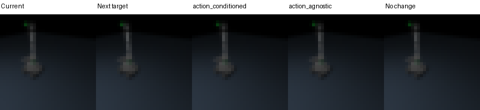

# Executed offline dynamics engineering benchmark

This is ENGINEERING_GLUE. H1–H5 remain **UNTESTED**. No simulator, policy,
controller or physical IO was executed by this benchmark. Its input is the real
saved NPZ format from the previously generated Mac CAD/MuJoCo pilot, not newly
collected physical data. The source dataset and all selected NPZ hashes were
checked before/after fitting and were not rewritten.

Run `action-centric-v2`, seed 41, Darwin/arm64 CPU, Torch 2.14.1, four Torch
threads. Two 54,916-parameter residual CNN/MLPs each execute **120 actual Adam
updates**, batch 8, 32×32 RGB, lr 0.001, same initialization and minibatch-index
sequence. Both change weights, preserve optimizer step 120, and reload with
maximum prediction difference **0.0**. Measured function elapsed **0.819139 s**
excludes interpreter/module startup and source-dataset generation; no speedup
comparison is made. Checkpoints/optimizers remain in the local artifact directory
in RESULT.json; source/results/logs/preview hashes are bound in SOURCE_MANIFEST.json.

Before fitting, episodes 0000–0008 are selected as world-model train: **9 episodes,
90 within-episode transitions**, including failed episode 0008. Episodes 0009–0011
are reserved for development: **3 episodes, 65 transitions**, including failed
episode 0009. These source episodes were originally imitation_train for an older
engineering pipeline; this reservation does not make them globally unseen or
sealed final tests. Declared source-session independence is unavailable. The
source manifest remains unchanged. For this old dataset, native event timestamps
are unavailable and the temporal claim is within-episode source index order plus
the existing command-before-next-command-state validation.

| Predictor | RGB MSE, transition mean | State MSE, transition mean | RGB MSE, episode mean | State MSE, episode mean |
|---|---:|---:|---:|---:|
| Action-conditioned | 2.811830e-6 | 1.593421e-5 | 1.216167e-5 | 8.237776e-5 |
| Zero-action, matched architecture | 2.807429e-6 | 1.625335e-5 | 1.214852e-5 | 8.293671e-5 |
| RGB/state persistence | 2.757815e-6 | 1.658343e-5 | 1.199251e-5 | 7.165755e-5 |
| RGB persistence, next command-state = current action | 2.757815e-6 | 6.019152e-16 | 1.199251e-5 | 3.052489e-16 |

RGB values are [0,1]; state errors use each source coordinate's fixed half-range
for normalization. Native-unit MAEs are provided **per coordinate** in RESULT.json.
Long failed episode 0009 supplies 59/65 development transitions, so transition
and episode means answer different questions. The 65 transitions are not 65
independent task trials. Both means are preserved instead of selecting a favorable
aggregation. No confidence/p-value or learned-task success is inferred.

**The learned models do not beat persistence on RGB, nor on episode-weighted
state error.** Tiny transition-weighted state differences do not establish an
action-conditioning advantage. Here state labels are command estimates; the
near-zero command-copy error exposes their construction and is not measured
physical dynamics. Images are dominated by a fixed scene; full-frame MSE alone
does not validate object effects, contacts, visual detail, counterfactuals,
long-horizon predictions or planning. There is no scientific novelty claim.

Six meaningful tests cover current-only inputs, episode boundaries, failed-source
retention, ID/hash/frame/session split aliases, sealed-role rejection, immutable
split reservation, native post-action timestamps, equal-capacity action masking,
actual finite optimization, exact model/optimizer reload, source immutability,
idempotence and tampered-artifact rejection.

The preview is a held-out **offline simulator episode**, enlarged by nearest
neighbor only. It is not a live camera stream or physical task result.

The implementation uses the standard [PyTorch convolution interface](https://docs.pytorch.org/docs/2.14/generated/torch.nn.Conv2d.html)
and [pixel mean-squared error](https://docs.pytorch.org/docs/2.14/generated/torch.nn.MSELoss.html).
